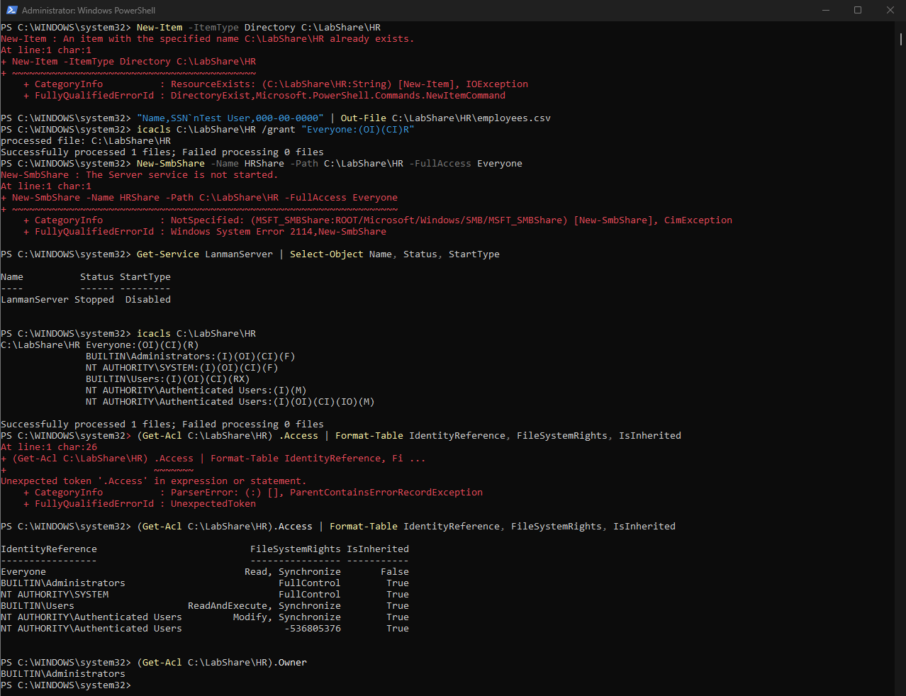
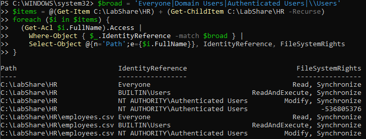
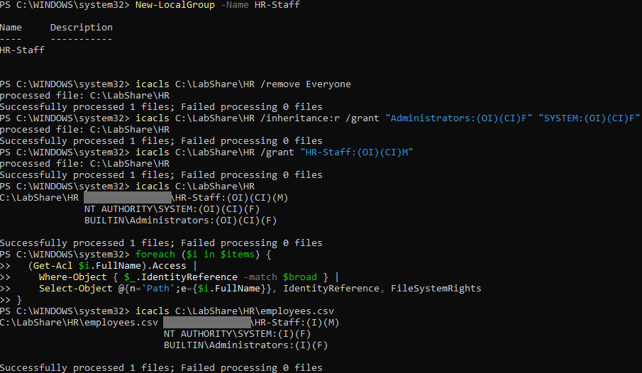
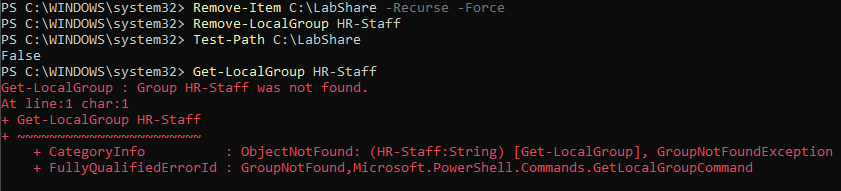

# Access Mapping: Find and Fix an Over-Shared Folder (NTFS)

## Summary

| Field | Details |
|-------|---------|
| Date | 2026-10-20 |
| Target | Windows PC with the Wazuh agent (CIS/SCA-hardened) |
| Tools | `icacls`, `Get-Acl`, PowerShell |
| Scenario | HR folder holding a file with SSN-shaped test data (`000-00-0000`, no real data) |
| Before | 1 planted grant, 7 broad-group findings across 2 objects |
| After | 0 findings |

I planted one bad permission on a folder of sensitive data. Then I mapped who could actually reach it, fixed it with least privilege, and reran the scan to prove the fix. The scan found more than I planted: two of the three broad groups came from inheritance, not from anything I set.

---

## Step 1: Build the Misconfiguration

From an admin PowerShell:

```powershell
New-Item -ItemType Directory C:\LabShare\HR
"Name,SSN`nTest User,000-00-0000" | Out-File C:\LabShare\HR\employees.csv
icacls C:\LabShare\HR /grant "Everyone:(OI)(CI)R"
New-SmbShare -Name HRShare -Path C:\LabShare\HR -FullAccess Everyone
```

`(OI)(CI)` makes the grant inherit to every file (object inherit) and subfolder (container inherit). One grant at the top spreads to everything below it.

The share step failed:

```
New-SmbShare : The Server service is not started.
FullyQualifiedErrorId : Windows System Error 2114,New-SmbShare
```

I checked why:

```powershell
Get-Service LanmanServer | Select-Object Name, Status, StartType
```

```
Name          Status  StartType
----          ------  ---------
LanmanServer  Stopped  Disabled
```

The Server service (LanmanServer) handles SMB file sharing, and it's **disabled** on this hardened endpoint. The machine doesn't need to share files, so I left it off instead of weakening the endpoint for the lab. The rest of the lab covers the NTFS permission layer.

---

## Step 2: Inspect the ACL (Before)

```powershell
icacls C:\LabShare\HR
```

```
C:\LabShare\HR Everyone:(OI)(CI)(R)
               BUILTIN\Administrators:(I)(OI)(CI)(F)
               NT AUTHORITY\SYSTEM:(I)(OI)(CI)(F)
               BUILTIN\Users:(I)(OI)(CI)(RX)
               NT AUTHORITY\Authenticated Users:(I)(M)
               NT AUTHORITY\Authenticated Users:(I)(OI)(CI)(IO)(M)
```

```powershell
(Get-Acl C:\LabShare\HR).Access | Format-Table IdentityReference, FileSystemRights, IsInherited
```

```
IdentityReference                           FileSystemRights IsInherited
-----------------                           ---------------- -----------
Everyone                                   Read, Synchronize       False
BUILTIN\Administrators                           FullControl        True
NT AUTHORITY\SYSTEM                              FullControl        True
BUILTIN\Users                    ReadAndExecute, Synchronize        True
NT AUTHORITY\Authenticated Users         Modify, Synchronize        True
NT AUTHORITY\Authenticated Users                  -536805376        True
```

```powershell
(Get-Acl C:\LabShare\HR).Owner
```

```
BUILTIN\Administrators
```



### Analysis

| Entry | Source | Risk |
|-------|--------|------|
| Everyone: Read | Explicit (planted) | Anyone can read the SSN file |
| Users: Read & Execute | Inherited from `C:\` | Every local user can read it |
| Authenticated Users: Modify | Inherited from `C:\` | **Worst entry.** Any signed-in account can edit or delete the file |
| Administrators, SYSTEM: Full | Inherited | Expected |

- **One planted grant became three broad groups.** An access review that only looks for explicit grants would miss two of them.
- **`-536805376`** is `0xE0010000`. That's Generic Read + Generic Write + Generic Execute + Delete on the inherit-only `(IO)` entry, which works out to Modify. .NET has no friendly name for that generic-rights combination, so it prints the raw mask.
- **The NTFS owner is `BUILTIN\Administrators`**, because the folder was created from an elevated shell. That's the IT custodian, not the business data owner. On a real HR share, the HR data owner should approve who gets access.

---

## Step 3: Scan for Broad Groups (Before)

Checking one folder by hand doesn't scale. This loop checks the folder and everything under it, and prints only broad-group entries:

```powershell
$broad = 'Everyone|Domain Users|Authenticated Users|\\Users'
$items = @(Get-Item C:\LabShare\HR) + (Get-ChildItem C:\LabShare\HR -Recurse)
foreach ($i in $items) {
  (Get-Acl $i.FullName).Access |
    Where-Object { $_.IdentityReference -match $broad } |
    Select-Object @{n='Path';e={$i.FullName}}, IdentityReference, FileSystemRights
}
```

```
Path                         IdentityReference                           FileSystemRights
----                         -----------------                           ----------------
C:\LabShare\HR               Everyone                                   Read, Synchronize
C:\LabShare\HR               BUILTIN\Users                    ReadAndExecute, Synchronize
C:\LabShare\HR               NT AUTHORITY\Authenticated Users         Modify, Synchronize
C:\LabShare\HR               NT AUTHORITY\Authenticated Users                  -536805376
C:\LabShare\HR\employees.csv Everyone                                   Read, Synchronize
C:\LabShare\HR\employees.csv BUILTIN\Users                    ReadAndExecute, Synchronize
C:\LabShare\HR\employees.csv NT AUTHORITY\Authenticated Users         Modify, Synchronize
```



**7 findings on 2 objects.** I never touched the file's permissions. All three broad groups flowed down from the folder. On a share with thousands of files, a few bad entries at the top produce thousands of findings, so the fix belongs at the top.

---

## Step 4: Fix with Least Privilege

```powershell
New-LocalGroup -Name HR-Staff
icacls C:\LabShare\HR /remove Everyone
icacls C:\LabShare\HR /inheritance:r /grant "Administrators:(OI)(CI)F" "SYSTEM:(OI)(CI)F"
icacls C:\LabShare\HR /grant "HR-Staff:(OI)(CI)M"
```

| Command | Why |
|---------|-----|
| `New-LocalGroup HR-Staff` | Grant to groups, not individuals. Joiners and leavers change group membership, not ACLs. |
| `/remove Everyone` | Removes the planted explicit grant. |
| `/inheritance:r` + re-grant Admins/SYSTEM | Cuts inheritance from `C:\` and removes the inherited Users and Authenticated Users entries. Re-granting in the same command keeps the folder manageable. **Removing Everyone alone would have left Authenticated Users with Modify.** |
| `HR-Staff: Modify` | Modify, not Full Control, so staff can't change permissions or take ownership. |

---

## Step 5: Verify (After)

I reran the Step 3 scan, and it returned **no output: 0 findings**, down from 7.

```powershell
icacls C:\LabShare\HR\employees.csv
```

```
C:\LabShare\HR\employees.csv <HOSTNAME>\HR-Staff:(I)(M)
                             NT AUTHORITY\SYSTEM:(I)(F)
                             BUILTIN\Administrators:(I)(F)
```



The file now inherits the corrected ACL from the folder. Fixing the top level fixed everything below it.

---

## Step 6: Cleanup

```powershell
Remove-Item C:\LabShare -Recurse -Force
Remove-LocalGroup HR-Staff
```



---

## Takeaways

- **Check inherited permissions, not just explicit grants.** One planted entry became three broad groups and seven findings.
- **Fix at the highest folder, then rescan to prove it.** It's the same find, fix, verify loop as my [detection gap](../detection/detection-gap-nmap-scan.md) and [SCA remediation](../hardening/sca-remediation.md) work.
- **Separate the NTFS owner (IT custodian) from the data owner (the business).** The data owner approves who belongs in the access group.
- **Hardening pays off.** The open-share step failed because the Server service is disabled on the endpoint.

## Skills Demonstrated

- NTFS permission analysis with `icacls` and `Get-Acl`
- Scripted access mapping in PowerShell (recursive ACL scan for broad groups)
- Least-privilege remediation: inheritance control, group-based access, Modify vs. Full Control
- Data owner vs. custodian distinction for access reviews
